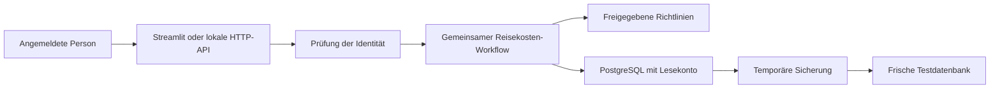

# Sicherheitsfallstudie

Diese Fallstudie untersucht den lokalen Reisekosten-Chatbot.
Sie nutzt ausgewählte Schritte aus BSI-Standard 200-2.
BSI steht für Bundesamt für Sicherheit in der Informationstechnik.
Betrachtet werden ein fiktiver Fachprozess und synthetische Daten.

## Geltungsbereich und Struktur

Zum Umfang gehören Anmeldung, Richtliniensuche und Reisekostenabruf.
Dazu kommen die lokale PostgreSQL-Datenbank und ihre Wiederherstellung.
Die Anwendungsprogrammierschnittstelle heißt kurz API.
Sie verbindet die Oberfläche mit der Anwendungslogik.



Die Identität stammt aus der Anmeldung.
Die Datenabfrage filtert nach dieser Identität.
Der Wiederherstellungstest nutzt dieselbe Anwendung gegen die neue Datenbank.
Der optionale externe Modellpfad liegt außerhalb dieses Tests.

## Schutzbedarf

Die Einstufung beschreibt einen angenommenen Betrieb mit echten Beschäftigtendaten.
Die Testdaten selbst sind fiktiv.

| Objekt | Vertraulichkeit | Integrität | Verfügbarkeit | Begründung |
| --- | --- | --- | --- | --- |
| Reisekostenfälle | Hoch | Hoch | Normal | Fremde Einsicht verletzt die Privatsphäre. Falsche Angaben können finanzielle Folgen haben. Eine manuelle Auskunft ist als Ausweichweg angenommen. |
| Konten und Berechtigungen | Hoch | Hoch | Normal | Ein gestohlenes Konto ermöglicht fremden Zugriff. Falsche Rollen erweitern Berechtigungen. |
| Richtlinien | Normal | Hoch | Normal | Fehlerhafte Regeln können falsche Auskünfte verursachen. |
| Datenbanksicherung | Hoch | Hoch | Normal | Sie enthält dieselben Fälle. Beschädigte Sicherungen erschweren die Wiederherstellung. |

Der Schutzbedarf der Fälle gilt auch für ihre Sicherungen.
Hoher Schutzbedarf würde vor einem echten Einsatz zusätzliche Analysen erfordern.
Die Schadensannahmen müssen dann mit den Fachverantwortlichen geprüft werden.

## Risiken und Behandlung

Bewertet werden plausible Ereignisse im angenommenen Betrieb.
Eintrittswahrscheinlichkeit und Auswirkung werden getrennt betrachtet.
Die Priorität ist eine qualitative Entscheidung.

| Risiko | Wahrscheinlichkeit | Auswirkung | Priorität | Behandlung und Restrisiko |
| --- | --- | --- | --- | --- |
| Fremdes Konto liest einen Fall | Mittel | Hoch | Hoch | Identität serverseitig binden. Zugriff nach Wiederherstellung erneut testen. Ein kompromittiertes berechtigtes Konto bleibt ein Risiko. |
| Anwendung verändert Abrechnungen | Mittel | Hoch | Hoch | Datenbankkonto auf Lesen beschränken. Schreibversuche testen. Administrative Konten bleiben privilegiert. |
| Sicherung ist unbrauchbar | Mittel | Hoch | Hoch | Sicherung in eine neue Datenbank einspielen. Inhalt und Anwendung prüfen. Ein einzelner Test deckt keine ganze Historie ab. |
| Sicherung wird kopiert | Mittel | Hoch | Hoch | Testdatei mit Dateirechten 0600 in privatem temporärem Ordner halten. Host-Administratoren bleiben zugriffsberechtigt. |
| Fragen oder Zugangsdaten erscheinen im Log | Mittel | Hoch | Hoch | Vorhandene Tests prüfen die Telemetrie. Andere Infrastruktur-Logs brauchen eine eigene Prüfung. |

Für die Demo übernimmt die Projektverantwortliche die fachliche Freigabe und den Betrieb.
Vor Änderungen prüft sie die Testnachweise.
Offene Risiken werden bei Änderungen und spätestens vor einer externen Bereitstellung neu bewertet.
Die Restrisiken gelten hier nur im synthetischen Lernaufbau als akzeptiert.

## Ausgewählte Anforderungen

Die Tabelle nutzt CON.3 aus Edition 2023 und ORP.4 aus Edition 2020.
CON bezeichnet Konzepte und Vorgehensweisen.
ORP bezeichnet Organisation und Personal.
Die Zuordnung ist eine begrenzte Lernanwendung der genannten Ausgaben.

| Referenz | Thema | Umsetzung und Nachweis | Stand |
| --- | --- | --- | --- |
| ORP.4.A2 | Berechtigungen vergeben und entziehen | Rollenfilter und Entzugstest in `tests/test_access_revocation.py`. Der Entzug wird im Test simuliert. | Teilweise. Ein organisatorischer Freigabeprozess bleibt offen. |
| CON.3.A5 | Regelmäßige Datensicherung | Der Workflow erstellt für den Test einen Snapshot. | Teilweise. Ein betrieblicher Sicherungsplan fehlt. |
| CON.3.A6 | Datensicherungskonzept | Umfang, Ablauf und Grenzen stehen unten. | Teilweise. Betriebsfristen und Verantwortungsvertretung bleiben offen. |
| CON.3.A14 | Schutz der Sicherungen | Privater temporärer Ordner. Dateirechte 0600. Automatische Bereinigung. | Teilweise. Verschlüsselung und getrennte Aufbewahrung fehlen. |
| CON.3.A15 | Sicherungen testen | `evaluation/backup_restore.py` stellt den Snapshot wieder her. Vier Tests prüfen Daten, Eigentümerzugriff, fremden Zugriff und Schreibrechte. | Im automatisierten Workflow prüfbar. Ergebnis im Laufbericht. |

## Wiederherstellung ausführen

Voraussetzung ist der lokale Container-Aufbau aus
[Travel API verification](travel-api-verification.md).

```bash
python -m evaluation.backup_restore --output .ci-artifacts/integration/backup-restore.json
```

Das Skript sichert die fiktive Datenbank mit `pg_dump`.
Es legt eine neue Datenbank mit zufälligem Namen an.
`pg_restore` spielt den Inhalt und die objektbezogenen Rechte ein.
Die vorhandene Leserrolle und die lokalen Demo-Konten müssen bereits bestehen.
Der Test löscht seine neue Datenbank und die temporäre Sicherung anschließend.

Der Bericht enthält die Laufzeit und vier Testergebnisse.
Die Laufzeit umfasst Sicherung und Wiederherstellung.
Passwörter und Verbindungsadressen stehen außerhalb des Berichts.
Der Workflow führt den Test bei jedem Push und Pull Request aus.
Pull Request bezeichnet einen Vorschlag, Änderungen in einen anderen Entwicklungszweig zu übernehmen.

## Offene Betriebsschritte

Für einen echten Betrieb fehlen feste Sicherungsintervalle und Aufbewahrungsfristen.
Auch ein zulässiger Datenverlust und eine maximale Ausfallzeit müssen vereinbart werden.
Konten, Richtliniendateien, Schlüssel und Konfiguration benötigen eigene Sicherungen.
Eine Wiederherstellung nach Verlust des gesamten Servers steht ebenfalls aus.

## Bezug zu ISO/IEC 27001

ISO steht für International Organization for Standardization.
IEC steht für International Electrotechnical Commission.
Die Norm beschreibt Anforderungen an ein Informationssicherheitsmanagementsystem.
Dieses verbindet Zuständigkeiten, Risikobehandlung und Wirksamkeitsprüfung.
Die Fallstudie übt diese Arbeitsweise in kleinem Umfang.
Die genaue Normzuordnung und eine organisationsweite Bewertung bleiben offen.

## Quellen

- [BSI-Standard 200-2](https://www.bsi.bund.de/SharedDocs/Downloads/DE/BSI/Grundschutz/BSI_Standards/standard_200_2.pdf?__blob=publicationFile&v=2)
- [CON.3 Datensicherungskonzept, Edition 2023](https://www.bsi.bund.de/SharedDocs/Downloads/DE/BSI/Grundschutz/IT-GS-Kompendium_Einzel_PDFs_2023/03_CON_Konzepte_und_Vorgehensweisen/CON_3_Datensicherungskonzept_Edition_2023.pdf?__blob=publicationFile&v=3)
- [ORP.4 Identitäts- und Berechtigungsmanagement, Edition 2020](https://www.bsi.bund.de/SharedDocs/Downloads/DE/BSI/Grundschutz/IT-GS-Kompendium/Archiv/Kompendium_Einzel_PDFs_2020/02_ORP_Organisation_und_Personal/ORP_4_Identitaets_und_Berechtigungsmanagement_Editon_2020.pdf?__blob=publicationFile&v=1)
- [ISO/IEC 27001](https://www.iso.org/standard/27001)
